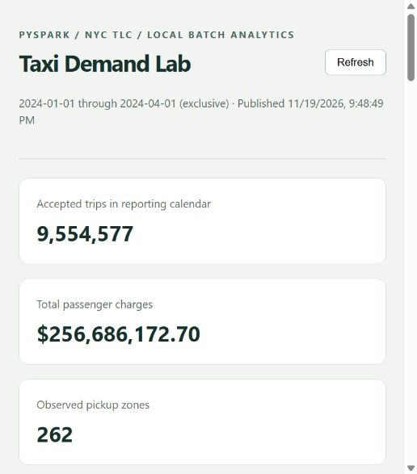
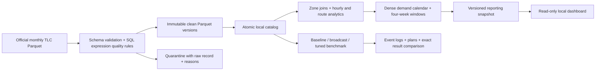

# NYC Taxi Spark Demand Lab

A separate PySpark portfolio project using the same NYC TLC yellow taxi dataset as the local Airflow platform. It demonstrates DataFrame transformations, joins, aggregation, window functions, partition pruning, physical-plan inspection and measured performance. It does not modify or depend on that project's database or services.

Verified locally on January–March 2024: **9,554,778 source records → 9,554,598 accepted / 180 quarantined**. On January's 2,964,568 accepted trips, the tuned benchmark median was **47.717 seconds** against a controlled baseline of **76.997 seconds**, with exact equality across nine measured outputs. Broadcasting alone had a slower median despite lower shuffle volume. See [individual runs and limitations](docs/VERIFICATION.md).



## Architecture

The main code to review is [DataFrame transformations](src/taxi_spark/transforms.py), [monthly publication and reporting](src/taxi_spark/pipeline.py), [benchmark workloads and event metrics](jobs/benchmark.py), and [exact benchmark result comparison](jobs/compare.py). [Spark fixture tests](tests/test_pipeline.py) exercise the same implementation used on the real data.



Spark runs inside a digest-pinned official Apache Spark **3.5.7** image with `local[2]`, a 768 MiB JVM heap, a 2.3 GB container limit and two CPUs. The inspected image uses Python 3.8.10 and Java 11.0.27; these are supported by Spark 3.5.7. This is single-machine parallel processing, not evidence of a distributed cluster deployment. The dashboard has no third-party dependencies and uses its own pinned Python image. Neither Spark nor a database exposes a host port; the dashboard binds only `127.0.0.1:8502`.

## Startup

Prerequisites: Docker Desktop with Linux containers, Compose v2 and host Python 3.8+. Run from this repository. On this machine Docker's directory must first be added to PowerShell's path:

```powershell
cd C:\Users\varun\Desktop\Airflow\nyc-taxi-spark-lab
$env:PATH="$env:LOCALAPPDATA\Programs\DockerDesktop\resources\bin;$env:PATH"
python scripts/prepare_inputs.py --from-existing ../nyc-taxi-data-platform/data
docker compose run --rm --no-deps spark /workspace/jobs/run.py ingest
docker compose run --rm --no-deps spark /workspace/jobs/run.py report
docker compose --profile dashboard up -d dashboard
```

Open [the dashboard](http://localhost:8502). The input helper copies source files and verifies SHA-256 without writing to the old repository. On a fresh machine without that repository:

```sh
python scripts/prepare_inputs.py --download --months 2024-01 2024-02 2024-03
```

Inputs, outputs, catalogs, event logs, tooling and local benchmarks live in ignored `data/`. Transient shuffle/cache files use `/tmp/spark-local` inside each Linux container to avoid Windows bind-mount overhead; they disappear with that batch container. No credentials are required. The dashboard reads only precomputed aggregate files through a read-only volume. Stop it with `docker compose --profile dashboard stop dashboard`; batch Spark containers exit automatically. No volumes or databases need resetting.

## Reprocessing and failure recovery

```sh
docker compose run --rm --no-deps spark /workspace/jobs/run.py ingest --months 2024-01 --reprocess
docker compose run --rm --no-deps spark /workspace/jobs/run.py ingest --months 2024-01 --reprocess --fail-before-publish
docker compose run --rm --no-deps spark /workspace/jobs/run.py report
```

The second command intentionally exits nonzero. An unchanged source checksum, zone checksum and quality-policy version is skipped unless `--reprocess` is supplied. A stricter rejection threshold still applies to skipped data. Each attempt writes a unique immutable version. The pipeline counts written accepted/quarantine files back, checks unchanged input hashes, then atomically replaces `catalog/partitions.json`. A failed replacement leaves the previous catalog and published files untouched. Earlier successful months survive a later failure in a multi-month invocation. A Linux advisory file lock excludes concurrent publishers and is released by the kernel when the process dies.

Audit JSON records per-attempt status and errors. Abrupt process termination can leave a `running` audit and unreferenced output directory; it does not advance the catalog. Old successful versions and failed versions are retained deliberately. There is no automatic garbage collection or backup recovery claim. Publication relies on local filesystem atomic rename and shared Linux `flock`; this is not an object-store transaction protocol. Use the Docker runtime on Windows, not native Windows Spark/file locking.

## Data semantics

- Each accepted physical source record is a trip. Identical-looking rows are preserved; there is no invented natural key or deduplication.
- Required source fields must have numeric or timestamp types. This project's actual source coverage is January–March 2024 yellow taxi; it does not claim every TLC schema works.
- Naive TLC timestamps remain local wall-clock `timestamp_ntz`. The UTC session setting avoids host-dependent interpretation during conversions; it does not assert that TLC timestamps are UTC. DST ambiguity remains.
- Missing timestamps, negative duration, invalid/fractional zone IDs, nonfinite/negative distance, and unusable fare/total amounts are quarantined. Every rejected record retains its original fields as JSON and all reason codes. Multiple reasons still count as one rejected record.
- Negative money and zero distance remain valid. Passenger counts are not needed by these analytics. Unsupported numeric precision fails the relevant fare/total quality check. Monetary values use `decimal(18,2)`; financial aggregations use exact decimal sums.
- Default rejection limit: 1%; empty/wholly rejected input fails. `source_rows = accepted_rows + rejected_rows` is enforced before publication.
- Clean storage is partitioned by `source_month`, the file's owning month. Cross-month pickup timestamps remain in that partition. Only reporting filters out dates outside the contiguous published source-month calendar, recording their count explicitly.
- The zone dimension enriches pickup and drop-off independently. The zone checksum must match every published partition before reporting; changed lookup data requires reprocessing. Enrichment count and hourly/route financial totals reconcile against accepted in-calendar facts.
- Demand uses a dense date × hour × observed-zone grid over the full calendar. Unobserved hours count as zero. For each zone/weekday/hour, a range window looks back 7–28 days, excluding the current day; the average is published only with four prior weekly observations. `lag` supplies the previous week and `dense_rank` ranks zone demand within each date/hour.
- Route median/p95 duration uses `percentile_approx` with accuracy 10,000. The dashboard route list requires at least 100 trips. Long accepted trips can influence the upper tail; it is not an outlier-corrected travel-time forecast.
- `total_collected_amount` is the signed TLC passenger charge, including recorded fees/tips and refunds, excluding cash tips. It is not operator revenue.

Reporting writes hourly, route and demand tables into one new directory and publishes one pointer after reconciliation. Dashboard freshness compares source versions with those used by the report. The dashboard's charts describe the entire displayed calendar; there are no misleading date filters applied to only some charts.

## Performance lab

```powershell
python scripts/benchmark_suite.py --month 2024-01 --repetitions 3
```

This starts one fresh Spark application per run. Each configuration gets one discarded full-workload warmup, then the run order rotates across measured repetitions. The discarded runs can warm filesystem caches; they do not warm the JVM of a subsequent fresh application. All cases select the same source month, enrich both zone names, group by pickup/drop-off IDs, labels, weekday and hour, sum exact charges and rank routes using a window. Zone IDs remain in the grain because zone display names are not necessarily unique. The action includes writing Parquet, so Spark's lazy execution cannot produce an empty timing.

| Case | Zone joins | AQE | Shuffle partitions |
|---|---|---|---:|
| `baseline` | Automatic broadcast disabled; ordinary joins | Off | 32 |
| `broadcast_only` | Explicit broadcast | Off | 32 |
| `tuned` | Explicit broadcast | On | 8 |

The broadcast-only comparison changes one factor; tuned changes AQE and shuffle count together, so do not assign its difference to one setting alone. SQL optimization may change physical plans: inspect the saved plans, not just configuration labels. All cases retain the same month filter; plans can show partition pruning in each case. The lab does not manufacture a speedup by filtering fewer records in the tuned case.

Per-run artifacts: query/physical plans, adaptive plan updates, Spark event log, output file count/bytes, and task shuffle/spill counters. The query timer excludes JVM startup, zone validation and a common initialization action. Task counters cover the entire application, including those preparatory actions; their scope is labeled in every metric record. Failed/speculative duplicate task attempts are excluded from task totals.

See [plan-reading notes](docs/PLAN_NOTES.md) for the observed join operators, storage versus execution partitions, output file counts, and the limits of the experiment.

The suite compares every measured result with distributed `exceptAll` in both directions, preserving duplicate multiplicity. Input partition versions must remain equal. Only then is a `*-verified.json` summary written and displayed on the dashboard. Medians, individual runs and output equality are reported even if tuning is slower. Hardware contention, OS filesystem cache and JVM variability remain uncontrolled; results support local observations, not general scalability or cost claims. Do not compare timings from different datasets or environments as if they were equivalent.

The reference result also reconciles its summed trip counts and exact charges against the published input partition. Three repetitions start twelve Spark applications in total, including discarded warmups; allow tens of minutes on a small local Docker runtime. Query timings exclude startup and do not describe the suite's total wall time.

## Tests and CI

```sh
docker compose run --rm --no-deps spark /workspace/tests/test_pipeline.py
python -m unittest discover -s tests -p test_dashboard.py -v
docker compose run --rm --no-deps spark /workspace/jobs/verify.py
```

The first command runs real Spark fixture tests for quality rules, duplicates/refunds, dense demand windows, schema/lookup failures, writer locking, repeated ingestion, controlled failed replacement and reporting reconciliation. The host HTTP test checks aggregate delivery and stale-source detection. `verify.py` processes real January data again, asserts exact multiset equality and aggregates after replacement, then injects failure and checks catalog/data preservation. It writes `data/real-verification.json` only after all assertions pass.

GitHub Actions uses the same pinned Spark image and tiny synthetic fixtures, never TLC downloads or a production database. The workflow configuration is included; remote execution is a separate claim from local execution. Ruff 0.14.5 checks undefined/unused names and syntax; `compileall` checks all Python entrypoints.

## Expansion

To extend to another contiguous source month, download it with `prepare_inputs.py --download --months YYYY-MM`, ingest it explicitly with `--months YYYY-MM`, then rebuild reporting. Validate new schemas and measure resources before expanding to a full year. Reporting bounds its calendar to 36 contiguous source months. Multi-node execution, cloud storage, streaming, forecasting, and production disaster recovery are outside this project's implemented scope.

See [acceptance checklist](docs/CHECKLIST.md) and [verification results](docs/VERIFICATION.md) for the executed scope and measured observations.

## References

- [Official TLC Parquet files and zone lookup](https://www.nyc.gov/site/tlc/about/tlc-trip-record-data.page)
- [Spark 3.5.7 runtime compatibility](https://spark.apache.org/docs/3.5.7/)
- [Spark SQL performance tuning](https://spark.apache.org/docs/3.5.7/sql-performance-tuning.html)
- [Spark Parquet partition discovery](https://spark.apache.org/docs/3.5.7/sql-data-sources-parquet.html)
